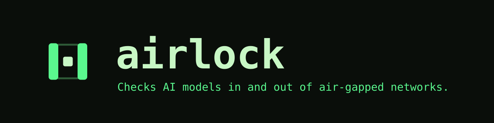
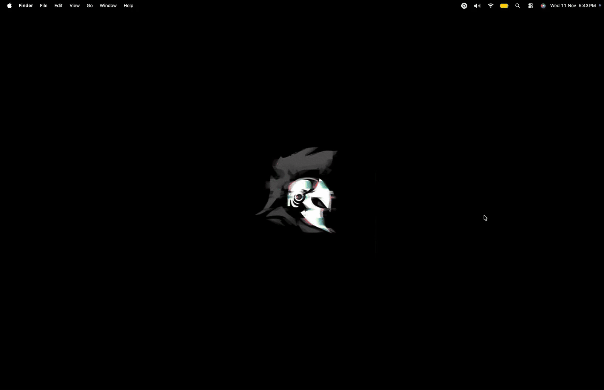
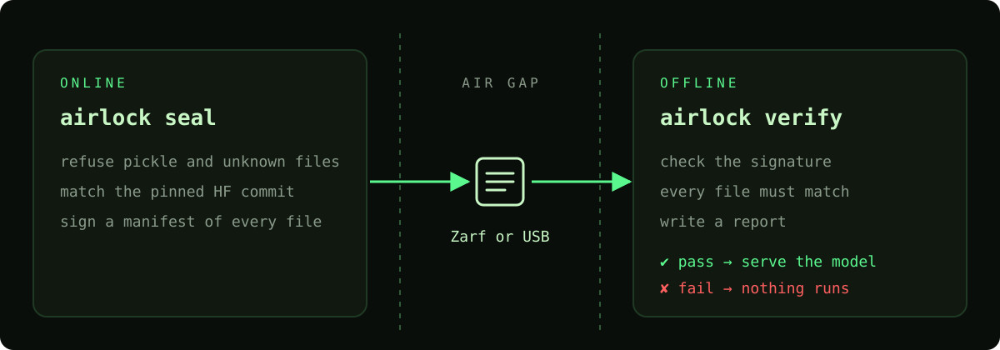
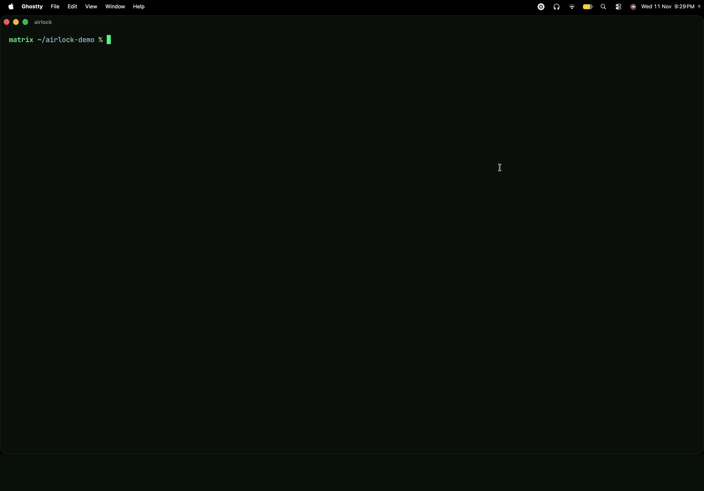

<h1 align="center"></h1>

<p align="center"><b>Zarf moves the boxes. airlock proves the model inside is safe, genuine and unchanged.</b></p>

<p align="center">
  <a href="#how-it-works">How it works</a> ·
  <a href="#quick-start">Quick start</a> ·
  <a href="#what-it-checks">What it checks</a> ·
  <a href="#with-zarf">With Zarf</a> ·
  <a href="#threat-model">Threat model</a>
</p>

airlock checks an AI model before it goes into an air-gapped network, then checks it again on the offline side before it runs. Zarf or a USB drive moves the files. airlock refuses unsafe formats, proves the weights are the ones you pinned, and leaves a report for the security team.



## How it works



| Command | Where | What it does |
|---|---|---|
| `airlock seal` | Online | Refuses formats that can run code, checks the weights against a pinned Hugging Face commit, and signs a manifest of every file. |
| `airlock verify` | Offline | Checks the signature and every file with no network and no other tools, then writes a Markdown report. |
| `airlock smoke` | Offline | Asks the running model server a question with a known answer and adds the result to the report. |
| `airlock check` | Anywhere | Runs only the format checks. |
| `airlock zarf` | Online | Writes a Zarf package that runs `airlock verify` during deploy. |

## Quick start

```sh
go build -o airlock .
cosign generate-key-pair
airlock seal ./bundle --key cosign.key --hf Qwen/Qwen2.5-0.5B-Instruct-GGUF --rev <40-char commit>
airlock verify ./bundle --key cosign.pub
```

After the model server starts:

```sh
llama-server -m bundle/qwen2.5-0.5b-instruct-q4_k_m.gguf --port 8080 --offline
airlock smoke --url http://127.0.0.1:8080
```

`smoke` waits for `/health`, asks the question through the OpenAI-compatible API, and the answer must equal `--expect` (default `4`, ignoring case and a trailing period). The answer is written to the report as quoted code, so nothing in it renders as Markdown. It works with llama.cpp and vLLM. It shows the server answers, not that it loaded the verified files.

Tested end to end with Qwen2.5 0.5B Instruct (Q4_K_M, commit `9217f5db`): the live Hugging Face check, seal, verify, and a smoke test that answered "4".

## What it checks



The poisoned copy in this demo has an edited chat template that tells users to run an attacker's script. airlock does not read chat templates. It catches the swap because the file no longer matches the signed manifest.

**When sealing (online)**

- Weights must be GGUF (v2 or v3) or safetensors, parsed in full. No bytes can hide between or after the tensors.
- Pickle files (`.bin`, `.pt`, `.ckpt` and similar) are refused. Metadata files are checked by content, and unknown file types are refused.
- With `--hf` and `--rev`, every file must match the upstream repo at that commit. Branch names are refused because they can move.
- With `--clamav`, a ClamAV scan runs. It is off by default; if you ask for it and it can't run, sealing fails.
- A manifest of every file and its SHA-256 is signed with cosign. Nothing is uploaded to a transparency log.

**When verifying (offline)**

- The signature is checked before the manifest is parsed.
- Files on disk must match the manifest exactly: no missing, extra, or changed files.
- Formats are checked again, on the same read that produces the hash.
- A Markdown report is written whether the check passes or fails, outside the bundle.

<details>
<summary>Format checks in detail</summary>

- GGUF and safetensors are parsed in full up to the tensor data. Every tensor's size must match its type and shape, and the tensors must fill the data section to the end of the file, with only GGUF's alignment padding between them.
- Duplicate metadata keys or tensor names, unknown types, and fields that are too long or run past the end of the file are refused.
- `.json` must parse, `.model` must start like a sentencepiece file, and text files (`.txt`, `.md`, `.jinja`, `LICENSE`, `NOTICE`, `.gitattributes`) must be UTF-8 with no NUL bytes. Binary pickles and zip archives are refused under any of these names.
- Symlinks, and file names with control characters, backticks, `|` or `:`, are refused.
- ClamAV is off by default because the scanner and its database are one more downloaded thing to trust.
- When verifying, names and sizes are compared before any file content is parsed.

</details>

## With Zarf

```sh
airlock zarf ./bundle --key cosign.pub
zarf package create . -o out --signing-key cosign.key
zarf package deploy out/zarf-package-airlock-model-*.tar.zst --key /etc/airlock/cosign.pub --verify=always
```

The generated package copies the bundle and runs `airlock verify` during deploy. Put the component that serves the model after it: if verification fails, Zarf stops and the model never starts.

Zarf's signature proves the package is the one the packager built, not what went into it. A model swapped before packaging passes Zarf's checks. airlock still refuses it, because it checks the model against its own seal, made earlier from the real files.

Always sign the package and deploy with `--verify=always`. On an unsigned package anyone in transit could delete the verify step, and Zarf's default (`--verify=if-possible`) deploys unsigned packages without complaint. The same cosign key can sign both the bundle and the package. Tested with Zarf v1.0.0: unsigned packages and packages signed by another key are refused before anything runs.

## Installing airlock on the offline host

Install two things once, through the site's normal software intake:

- the airlock binary at `/usr/local/bin/airlock`
- the public key at `/etc/airlock/cosign.pub`

Change the paths with `--inside-bin` and `--inside-key`. The deploy step calls the binary by absolute path, never through `PATH`.

Neither is shipped inside the package by default: anyone who could alter the package could also swap the key and the verifier. You can also rebuild from source on the offline side and compare hashes, since builds are reproducible with the same Go version:

```sh
CGO_ENABLED=0 GOOS=linux GOARCH=amd64 go build -trimpath -buildvcs=false -o airlock . && sha256sum airlock
```

`-buildvcs=false` matters: without it, a build from a git checkout embeds the commit and gets a different hash. The binary has no dependencies outside the Go standard library. cosign is only needed for signing.

## Threat model

**airlock detects**

- a file changed, added, or removed after sealing
- a bundle signed by a key the offline host does not trust
- pickle-based model files
- weights that differ from the pinned upstream commit

**It does not cover**

| Gap | Details |
|---|---|
| A stolen signing key | Keep `cosign.key` off shared machines. To rotate, install a new public key on the offline host through the same trusted channel. |
| Harmful model behaviour | A model in a safe format from the right commit can still be a bad model. airlock does not evaluate outputs. |
| Changes after verification | Someone with write access between `verify` and model load could swap files. The Zarf integration runs `verify` during deploy to keep that window small. |
| A malicious upstream commit | Pinning stops later changes, but if the pinned commit is bad, airlock accepts it. |
| Rollback | An older bundle signed by the same key still verifies. Rotate keys or track versions on the offline side. |
| Chat templates | Templates in `.jinja` files, `tokenizer_config.json` or GGUF metadata are not inspected. Use a loader that renders them in a sandbox (see CVE-2024-34359). |
| Metadata values and tensor bytes | GGUF metadata values are read but not judged, tensor bytes can be anything, the `.model` check reads only the first byte, and a plain-text (protocol-0) pickle inside a `.txt` file is not detected. Loaders pick a parser by file name, so these are not unpickled, but a loader that sniffs content could treat them differently. |
| A compromised online machine | Seal trusts the machine it runs on. Someone who can write to the bundle while it is sealed could change files before they are signed. |
| Small upstream files | Hugging Face publishes only a git SHA-1 for non-LFS files, so those are matched by SHA-1. Weights are LFS files and are matched by SHA-256. |
| Transparency logs | Signatures are key-based only, because air-gapped sites usually cannot reach Rekor. |
| Vulnerabilities in the serving image | Use Zarf's SBOMs or a scanner. |

## Status

Not done yet: an offline vulnerability re-scan with a bundled database, and updates that ship only changed files.

The demos are recorded with the scripts in [`demo/`](demo/).

<p align="center"></p>
